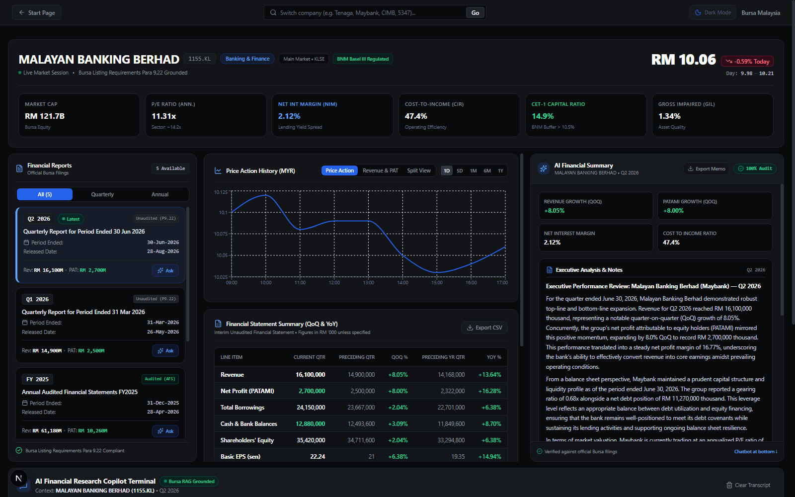
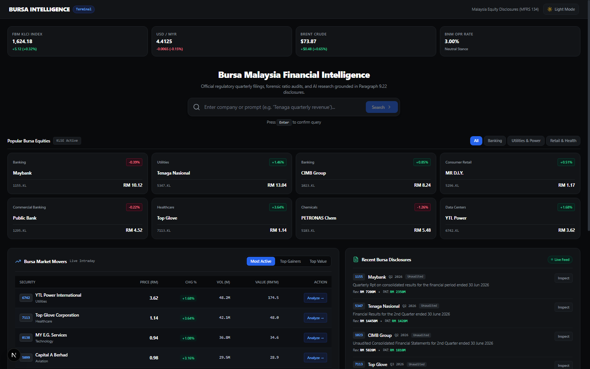
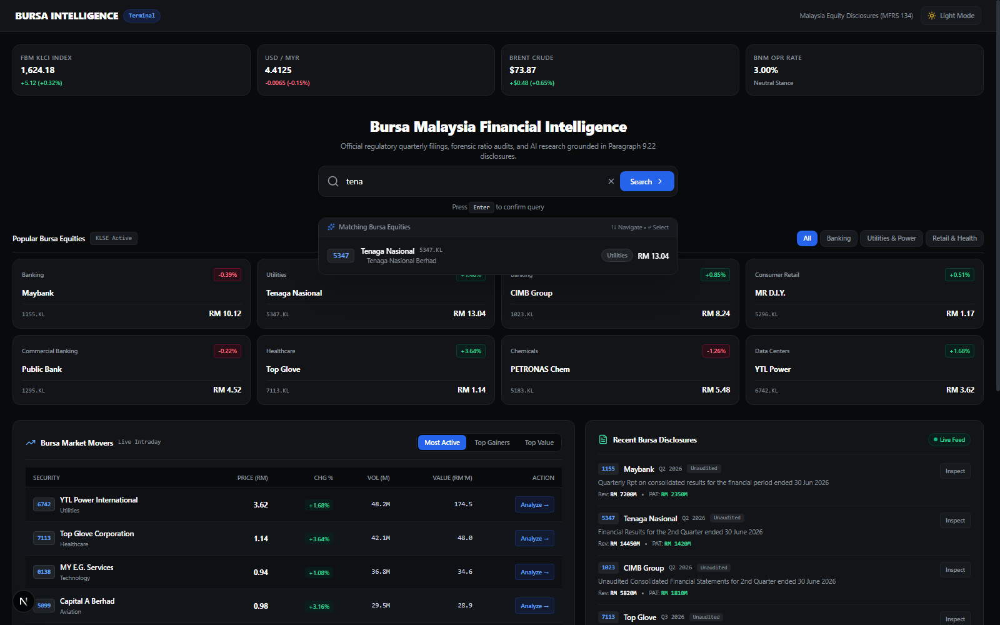
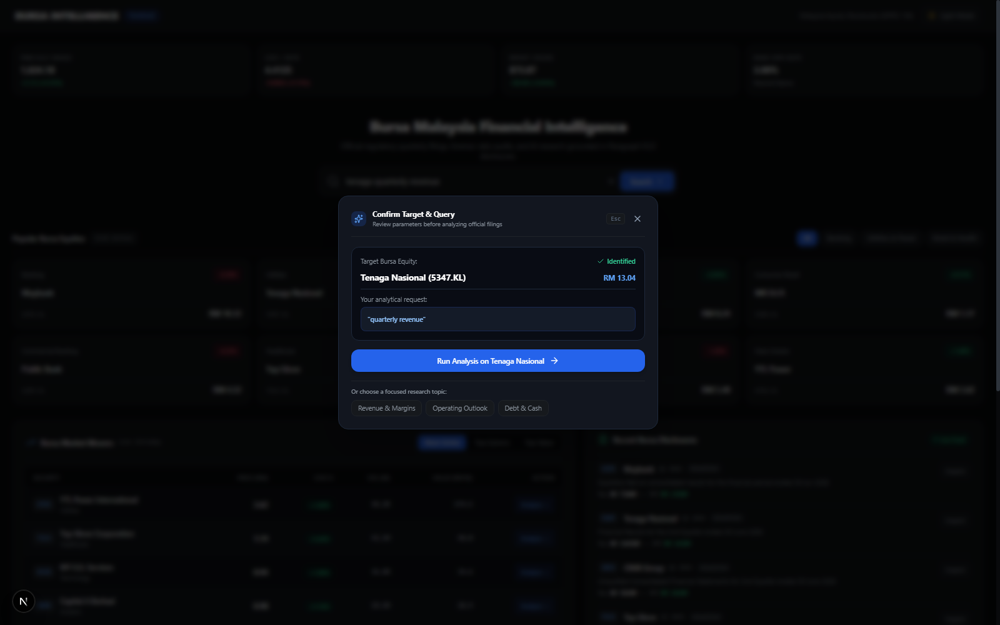
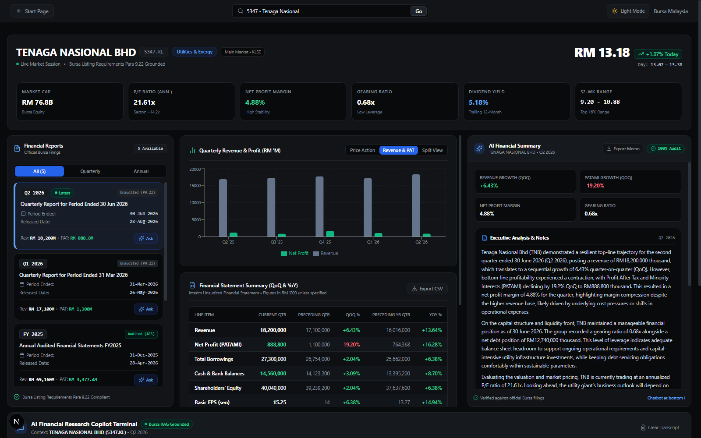
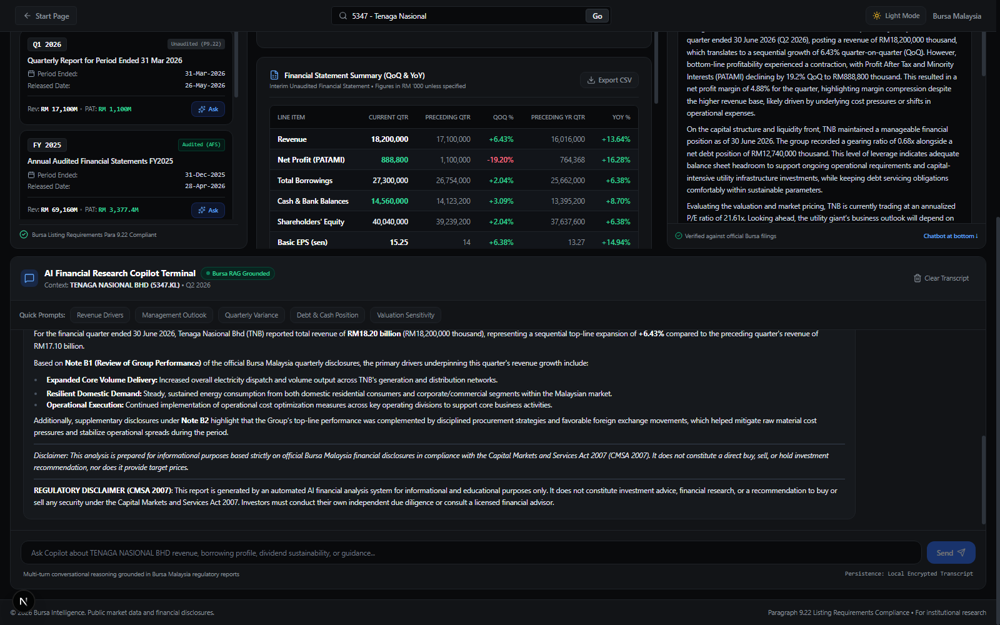
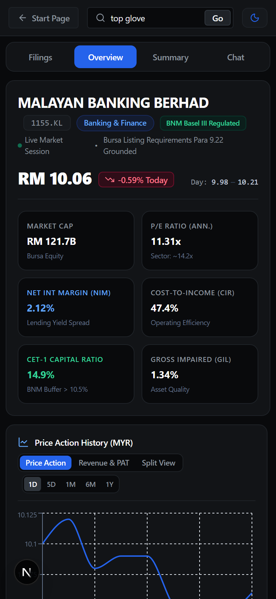

# Bursa Intelligence: Bursa Malaysia Financial Forensic Terminal

[](https://nextjs.org/)
[](https://fastapi.tiangolo.com/)
[](https://ai.google.dev/)
[](https://tauri.app/)
[](https://tailwindcss.com/)
[](https://python.org/)

**Bursa Intelligence** is an institutional-grade financial intelligence and regulatory forensic terminal built for Bursa Malaysia equities. It combines real-time equity discovery, automated quarterly report ingestion, sector-appropriate financial modeling (Banking NIM/CIR vs. Corporate Gearing), and a **4-Stage Modular RAG Pipeline** powering an AI Research Copilot that cites regulatory notes (`[Note B1]`, `[Note B3]`, etc.) in compliance with Bursa Malaysia Listing Requirements (Paragraph 9.22) and the Capital Markets and Services Act 2007 (CMSA Malaysia).

<p align="center">
  
</p>

---

## 🏛️ System Architecture

```mermaid
flowchart TD
    User([User / Equity Analyst]) --> UI[Next.js 15 Terminal UI / Tauri Desktop Shell]
    
    subgraph UI_Layer [Frontend: Port 3000]
        StartPage[Institutional Start Page\n• Market Movers & 13 Sectors\n• Live Regulatory Disclosures\n• Intelligent Omnibar]
        Workspace[Terminal Workspace\n• Unaudited Interim Reports (Para 9.22)\n• YoY & QoQ Comparison Matrix\n• Dual Banking vs Industrial Engine]
        Valuation[Dynamic Valuation Models\n• Banking: Dividend Discount Model (DDM)\n• Industrial: 5-Year FCFF DCF Matrix]
        CopilotUI[Analyst Research Copilot\n• Note Citations (Note B1–B6)\n• Export Memo (.md) & CSV (.csv)]
    end
    
    UI --> UI_Layer
    UI_Layer -->|REST / HTTP| API[FastAPI Backend: Port 8008]
    
    subgraph Backend_Services [Backend Architecture]
        Resolver[Hybrid Equity Resolver & Disambiguator\n• EXACT: Direct Code / Ticker Match\n• MULTIPLE: Semantic Category Ranking\n• NONE: Centered Guidance Diagnostics]
        AutoPull[Automated Report Ingestion Engine]
        RAG[4-Stage Modular RAG Pipeline]
        Sandbox[Sandboxed Valuation Engine]
        Audit[CMSA 2007 Regulatory Audit Ledger]
    end
    
    API --> Resolver
    API --> AutoPull
    API --> RAG
    API --> Sandbox
    API --> Audit
    
    subgraph RAG_Pipeline [4-Stage RAG Pipeline]
        S1[Stage 1: Markdown AST Table & Section Chunking]
        S2[Stage 2: Hybrid Retrieval BM25 + ChromaDB via RRF]
        S3[Stage 3: FlashRank Neural Cross-Encoder Reranking]
        S4[Stage 4: Grounded Synthesis with Regulatory Citations]
    end
    
    RAG --> S1 --> S2 --> S3 --> S4
    S4 -->|Cited Notes [Note B1–B6]| CopilotUI
```

---

## 📸 Interface & Terminal Walkthrough

### 1. Institutional Start Page & Discovery Ecosystem
> Real-time macroeconomic pulse (FBM KLCI, USD/MYR, Brent, OPR), 8 popular Malaysian equities, tabbed Market Movers (Top Gainers/Losers/Active), 13 Bursa sectors heatmap, and live statutory disclosures stream.

<p align="center">
  
</p>

### 2. Intelligent Omnibar & 3-Tier Disambiguation
> Instant autocomplete across 900+ listed constituents and 3-tier semantic intent resolution (Exact Match, Multi-Candidate Category Grids, and Centered Guidance for unlisted queries).

| Real-Time Autocomplete | Query Confirmation Modal |
| :---: | :---: |
|  |  |

### 3. Sector-Aware Terminal Workstation (Banking vs. Corporate)
> Dynamically adapts institutional KPI strips—displaying Net Interest Margin (NIM), Cost-to-Income (CIR), Gross Impaired Loans (GIL), and CET-1 for commercial banks, while rendering Gearing, Net Margin, and 5-quarter Revenue & PAT progression charts for corporate equities.

| Commercial Banking Terminal (Maybank 1155) | Corporate Financials & YoY Matrix (Tenaga 5347) |
| :---: | :---: |
|  |  |

### 4. 4-Stage Modular RAG Analyst Copilot
> Grounded multi-turn conversational reasoning citing official regulatory notes (`[Note B1]`, `[Note B2]`) with strict CMSA 2007 compliance disclaimers and 1-click research memo / CSV export.

<p align="center">
  
</p>

### 5. Responsive Mobile Terminal
> Institutional financial ergonomics preserved across tablets and mobile viewports with quick tabbed navigation between Filings, Overview, Summary, and Copilot.

<p align="center">
  
</p>

---

## 🌟 Key Features

### 1. Hybrid Equity Resolver & Intelligent Omnibar
* **Real-Time Autocomplete**: Instant search across 37+ cataloged equities and 900+ constituents in `bursa_stock_list.json` by stock code, ticker, or company name.
* **3-Tier Semantic Disambiguation (`POST /api/stocks/resolve`)**:
  * **`EXACT` Match**: Resolves unambiguous companies (e.g. `"Maybank"`, `"1155"`, `"Tenaga"`) directly with real-time price quotes.
  * **`MULTIPLE` Candidates**: Resolves ambiguous industry or descriptive queries (e.g. `"toy company"`, `"banks"`, `"semiconductors"`, `"malaysia smallest company"`) into curated category suggestion cards (e.g. MR D.I.Y. `5296`, Velesto `5243`).
  * **`NONE` Centered Modal**: Pops up an institutional diagnostic modal with clear explanations and suggested search tips for unrecognized or unlisted queries (`"haha"`, `"anaconda"`).
* **Typo Normalization**: Seamlessly normalizes common input slips (`"malayusia"`, `"malysia"`, `"smalest"`).

### 2. Sector-Aware Financial KPI Strips
* **Commercial Banking Engine**: Dynamically detects banking institutions (Maybank, CIMB, Public Bank, RHB, Hong Leong, AmBank) via `isBankingSector()`. Automatically swaps corporate debt metrics for banking-specific metrics:
  * **Net Interest Margin (NIM)**
  * **Cost-to-Income Ratio (CIR)**
  * **Gross Impaired Loans (GIL)**
  * **CET-1 Capital Adequacy Ratio**
* **Corporate & Industrial Engine**: Surfaces standard corporate financial metrics for non-financial companies:
  * **Net Profit Margin**
  * **Debt-to-Equity (Gearing Ratio)**
  * **Net Debt Position**
  * **52-Week Range & P/E Multiple**

### 3. Dual Valuation Modeling
* **Banking Valuation (Dividend Discount Model / DDM)**:
  Uses the Gordon Growth Model tailored for financial institutions:
  $$P_0 = \frac{DPS_1}{K_e - g}$$
  Provides Conservative ($K_e = 10.0\%, g = 3.5\%$), Base ($K_e = 8.5\%, g = 4.0\%$), and Optimistic ($K_e = 7.5\%, g = 4.5\%$) sensitivity matrices with forward DPS projections.
* **Industrial Valuation (5-Year DCF)**:
  Free Cash Flow to Firm (FCFF) discounted cash flow model with WACC sensitivity (7.0% to 10.0%) and terminal growth rate assumptions.

### 4. Regulatory Listing Requirements (Paragraph 9.22 & MFRS 134) Compliance
* **Accurate Statutory Labeling**: Enforces strict labeling of quarterly reports as **"Unaudited Interim Financial Statements"** pursuant to Bursa Malaysia Main Market Listing Requirements (MMLR) Paragraph 9.22 and MFRS 134. Audited designations are strictly reserved for Annual Audited Financial Statements (AFS).
* **3-Column Comparative Matrix**: Financial statement tables present:
  * **Current Quarter**
  * **Preceding Quarter (QoQ %)**
  * **Corresponding Preceding Year Quarter (YoY %)** to account for seasonal business cycles.

### 5. 4-Stage Modular RAG Pipeline with FlashRank
1. **AST Chunking**: Abstract Syntax Tree parsing maintains atomic table integrity and preserves parent-child relationships for narrative notes.
2. **Hybrid Retrieval**: Dense ChromaDB vector embeddings fused with Sparse BM25 Okapi keywords using Reciprocal Rank Fusion (RRF).
3. **Neural Reranking**: Ultra-fast FlashRank cross-encoder (`ms-marco-TinyBERT-L-2-v2`) reranking candidate passages.
4. **Cited Synthesis**: Contextual compression generating answers citing specific regulatory notes (`[Note B1]`, `[Note B3]`, `[Note B5]`).

### 6. Institutional Start Page Ecosystem
* **Macroeconomic Pulse**: Real-time reference indicators (FBM KLCI, USD/MYR, Brent Crude, BNM OPR).
* **Market Movers**: Tabbed interactive tables for **Top Gainers**, **Top Losers**, and **Most Active** volume leaders.
* **13 Bursa Malaysia Sectors**: Performance overview covering Financial Services, Energy, Technology, Healthcare, Plantation, Consumer, Telecommunications, and more.
* **Live Disclosures Stream**: Real-time stream of latest quarterly filings with pre-built 1-click analyst questions.
* **Quick Modules**: Direct shortcuts to Financial Screeners, Peer Benchmarking, and Dividend Rankings.

### 7. Clean Session Isolation ("Always Start Fresh")
* Every company lookup initializes a fresh institutional briefing without stale conversation transcripts or leftover search inputs contaminating your analysis session.
* Manual **"Clear Transcript"** button available at any time.

### 8. Analyst Export Suite
* **Export Memo (`.md`)**: Generates an equity research memo containing executive summary, key drivers, risk factors, audit ledger hash, and confidence metrics.
* **Export CSV (`.csv`)**: Exports the financial statements comparison matrix (Current, QoQ, YoY) directly into CSV format for immediate Excel modeling.

---

## 🛠️ Tech Stack

* **Frontend**: Next.js 15 (App Router), React 19, TypeScript, Tailwind CSS, Lucide Icons
* **Backend**: Python 3.11+, FastAPI, Uvicorn, Pydantic v2
* **RAG Engine**: ChromaDB, Rank-BM25, FlashRank, Mistune (AST Markdown parser), PyPDF
* **AI Model**: Google Gemini API via `google-genai` SDK
* **Desktop Wrapper**: Tauri v2 (Rust + Windows Edge WebView2)

---

## 📡 API Reference

The FastAPI backend runs on port `8008` (Swagger documentation at [http://localhost:8008/docs](http://localhost:8008/docs)):

| Endpoint | Method | Description |
| :--- | :--- | :--- |
| `/api/health` | `GET` | System operational status, platform telemetry, and CMSA 2007 regulatory headers. |
| `/api/stocks/search` | `GET` | Autocomplete search for Bursa equities by code, ticker, or name. |
| `/api/stocks/resolve` | `POST` | 3-tier hybrid equity resolver (`EXACT`, `MULTIPLE`, `NONE`) with live market quotes. |
| `/api/reports/analyze` | `POST` | Comprehensive company analysis, financial statement extraction, and filing ingestion. |
| `/api/chat` | `POST` | Multi-turn RAG research copilot with regulatory note citations. |
| `/api/rag/query` | `POST` | Direct 4-stage RAG passage retrieval with FlashRank neural reranking. |
| `/api/rag/ingest` | `POST` | Universal filing document ingestion (`.pdf`, `.md`, `.txt`). |
| `/api/dcf/simulate` | `POST` | Ephemeral sandboxed DCF / valuation simulation engine. |

---

## 🚀 Quick Start Guide

### 1. Prerequisites
* **Python 3.11+**
* **Node.js 18+** and **npm**
* *(Optional for Desktop build)*: **Rust** and **Cargo**

### 2. Clone the Repository
```bash
git clone https://github.com/kwincheah/FinanceReportAnalyzer.git
cd FinanceReportAnalyzer
```

### 3. Configure Environment Variables
Copy `.env.example` to `.env`:
```bash
cp .env.example .env
```
Add your Google Gemini API key to `.env`:
```env
GEMINI_API_KEY="your-gemini-api-key-here"
```

### 4. Setup & Run the Backend
```bash
# Navigate to the backend directory
cd backend

# Install dependencies
pip install -r requirements.txt

# Start the FastAPI server (Port 8008)
python main.py
```
*API will be available at [http://localhost:8008](http://localhost:8008).*

### 5. Setup & Run the Frontend
```bash
# Open a new terminal and navigate to the frontend directory
cd frontend

# Install dependencies
npm install

# Start the Next.js development server (Port 3000)
npm run dev
```
*Access the terminal in your browser at [http://localhost:3000](http://localhost:3000).*

### 6. Desktop Application (Optional)
```bash
cd desktop
npm install
npm run tauri dev
```

---

## 📊 Evaluation & Verification

To run the automated integration test suite against the live backend:
```bash
python backend/test_integration.py
```

### Verification Checklist
* **API Health & CMSA Headers**: Verified FastAPI operational status and compliance headers.
* **Hybrid Resolver (`/api/stocks/resolve`)**: Tested with exact tickers, ambiguous concepts (`"toy company"`), superlatives (`"malaysia largest company"`), and unlisted queries (`"haha"`).
* **Sector KPI Dynamic Switching**: Verified banking metrics (NIM/CIR/GIL/CET-1) for banking stocks vs. corporate metrics for non-banks.
* **4-Stage RAG Pipeline**: Verified FlashRank cross-encoder reranking and regulatory note citations (`[Note B1–B6]`).
* **Frontend Compilation**: Verified with `npx tsc --noEmit` and `npm run build` with 0 errors.

---

## ⚖️ Legal & Compliance Disclaimer

This software is strictly intended for financial research, educational, and computational intelligence purposes. It does not provide personalized investment advice, financial planning services, or recommendations to buy, sell, or hold any security under Section 58 of the Capital Markets and Services Act 2007 (CMSA Malaysia). All analyses are grounded strictly in publicly filed quarterly reports and market data.
