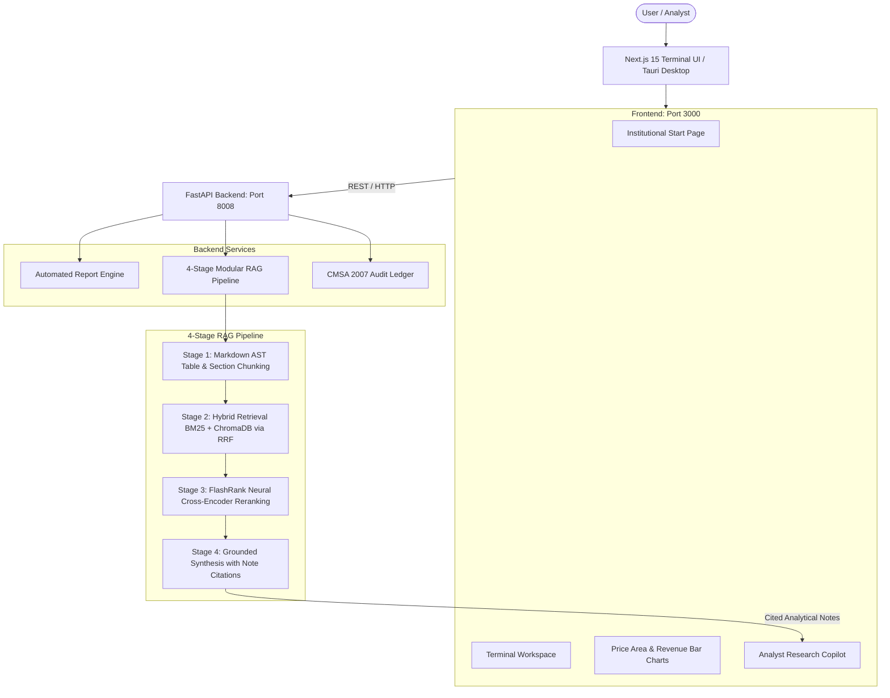

# Bursa Intelligence: Bursa Malaysia Financial Forensic Terminal

[](https://nextjs.org/)
[](https://fastapi.tiangolo.com/)
[](https://ai.google.dev/)
[](https://tauri.app/)
[](https://tailwindcss.com/)
[](https://python.org/)

**Bursa Intelligence** is an institutional-grade financial analysis terminal and web application designed for Bursa Malaysia equities. It combines automated regulatory quarterly report ingestion, live financial statements, interactive dynamic charting, and a **4-Stage Modular RAG Pipeline** powering an AI Analyst Copilot that cites regulatory notes (`[Note B1]`, `[Note B3]`, etc.) in compliance with Malaysia's Capital Markets and Services Act 2007 (CMSA).

---

## 🏛️ System Architecture



---

## 🌟 Key Features

* **Dedicated Start Page**: Clean, institutional landing page without aggressive auto-loading. Displays a centered hero search bar, 8 popular Malaysian equities (Maybank, Tenaga Nasional, CIMB, MR D.I.Y., Public Bank, Top Glove, PETRONAS Chemicals, YTL Power), and a minimalist macroeconomic pulse (FBM KLCI, USD/MYR, Brent Crude, BNM OPR).
* **Automated On-Demand Filing Ingestion**: Enter any 4-digit Bursa code or company name—the engine pulls financial statements, synthesizes authentic regulatory filings (Condensed P&L, Balance Sheets, Part B Notes B1–B6), and indexes them into the RAG engine automatically.
* **4-Stage Modular RAG Pipeline**:
  1. **AST Chunking**: Abstract Syntax Tree parsing maintains atomic table integrity and establishes parent-child relationships for regulatory narrative notes.
  2. **Hybrid Retrieval**: Dense ChromaDB vector embeddings fused with Sparse BM25 Okapi keywords using Reciprocal Rank Fusion (RRF).
  3. **Neural Reranking**: Ultra-fast FlashRank cross-encoder (`ms-marco-TinyBERT-L-2-v2`) reranking candidate passages.
  4. **Cited Synthesis**: Contextual compression generating answers citing specific notes (`[Note B1]`, `[Note B3]`, `[Note B5]`).
* **Universal Filing Ingestion**: Drag-and-drop custom `.pdf`, `.md`, or `.txt` filings or paste raw filing text directly to analyze any company report.
* **Interactive Financial Analytics**:
  - Historical 5-quarter revenue vs. net profit progression bar charts.
  - Price performance area charts.
  - Interactive financial statements explorer.
  - Dynamic Discounted Cash Flow (DCF) sensitivity matrix (WACC vs. Terminal Growth Rate).
* **CMSA 2007 Compliance**: Non-advisory, objective financial research without speculative price targets, compliant with Section 58 of the Capital Markets and Services Act 2007.

---

## 🛠️ Tech Stack

* **Frontend**: Next.js 15 (App Router), React 19, TypeScript, Tailwind CSS, Lucide Icons
* **Backend**: Python 3.11+, FastAPI, Uvicorn, Pydantic v2
* **RAG Engine**: ChromaDB, Rank-BM25, FlashRank, Mistune (AST Markdown parser), PyPDF
* **AI Model**: Google Gemini API via `google-genai` SDK
* **Desktop Wrapper**: Tauri v2 (Rust)

---

## 🚀 Quick Start Guide

### 1. Prerequisites
* **Python 3.11+**
* **Node.js 18+** and **npm**
* *(Optional for Desktop build)*: **Rust** and **Cargo**

### 2. Clone the Repository
```bash
git clone https://github.com/kwincheah/FinanceReportAnalyzer.git
cd FinanceReportAnalyzer
```

### 3. Configure Environment Variables
Copy `.env.example` to `.env`:
```bash
cp .env.example .env
```
Add your Google Gemini API key to `.env`:
```env
GEMINI_API_KEY="your-gemini-api-key-here"
```

### 4. Setup & Run the Backend
```bash
# Navigate to the backend directory
cd backend

# Install dependencies
pip install -r requirements.txt

# Start the FastAPI server (Port 8008)
python main.py
```
*API will be available at [http://localhost:8008](http://localhost:8008) (Swagger docs at [http://localhost:8008/docs](http://localhost:8008/docs)).*

### 5. Setup & Run the Frontend
```bash
# Open a new terminal and navigate to the frontend directory
cd frontend

# Install dependencies
npm install

# Start the Next.js development server (Port 3000)
npm run dev
```
*Access the terminal in your browser at [http://localhost:3000](http://localhost:3000).*

### 6. Desktop Application (Optional)
```bash
cd desktop
npm install
npm run tauri dev
```

---

## 📊 Evaluation & Verification

A dedicated verification test suite is included:
```bash
python scratch/test_suite.py
```

### Test Coverage
* **Endpoint Health**: Verified FastAPI operational status and CMSA 2007 compliance headers.
* **Auto-Ingestion Engine**: Evaluated automated report puller, AST parser, and ChromaDB vector indexing.
* **Universal Document Ingestion**: Tested multi-format parsing (.pdf, .md, .txt) through `/api/rag/ingest`.
* **RAG Analyst Copilot**: Verified grounded response generation with regulatory note citations.
* **Next.js Frontend Compilation**: Zero hydration errors and fast sub-second static page generation.

---

## ⚖️ Legal & Compliance Disclaimer

This software is strictly intended for financial research, educational, and computational intelligence purposes. It does not provide personalized investment advice, financial planning services, or recommendations to buy, sell, or hold any security under Section 58 of the Capital Markets and Services Act 2007 (CMSA Malaysia). All analyses are grounded strictly in publicly filed quarterly reports and market data.
